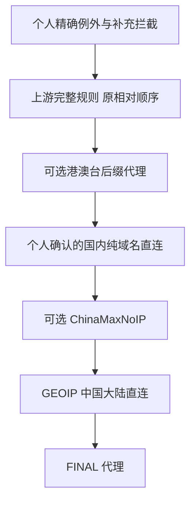
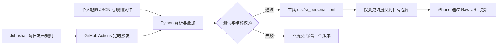

# Shadowrocket Personal｜配置优化与 GitHub 自动构建方案

- 版本：v1.0
- 编制日期：2026-11-20
- 基础规则：Johnshall / Shadowrocket-ADBlock-Rules-Forever / `sr_cnip_ad.conf`
- 适用环境：iPhone / Shadowrocket / 规则分流
- 范围：仅处理配置文件及其自动构建；不调整 App 的全局软件设置、节点订阅或 iOS 设置。

## 1. 目标与设计原则

1. 保持中国大陆业务优先直连、境外业务优先代理，并保留广告与隐私追踪拦截。
2. 港澳台业务继续保留原有代理策略；根据实际业务日志补充精确代理规则，不仅凭网站名称判断归属。
3. 减少 DoH 服务自身的引导 DNS 解析、非必要的规则匹配解析和多服务器并发请求。
4. 显式设定加密 DNS 回退，避免可控的系统 DNS 回退；防止不支持 UDP 的代理策略意外直连。
5. 每天获取上游最新规则，自动叠加个人配置，失败时保留上一份可用产物。
6. 最小改动、可配置、可测试、可回滚，不盲目合并所有广告库或调整上游的规则顺序。

**不能保证**：所有 iOS DNS 流量均被接管、所有境外站点永远走代理、所有无效 DNS 查询消失，或者修改后必然更快。App 自行解析、旁路流量、代理端解析、CDN 调度及节点能力都会影响结果。

## 2. 上游规则现状与优化边界

核对公开原文 [1]：本次获取的构建标记为 `UTC 2026-11-18 23:02:41`，共约 53,691 行（含注释及配置）。上游每天构建，后续内容可能变化。

| 配置区域 | 上游现状 | 本方案处理 |
| --- | --- | --- |
| `[General]` | 国内域名形式 DoH；存在旁路和局域网配置 | 替换 DNS、补充安全参数；旁路配置原样保留 |
| `[Rule]` 前部 | 存在手工代理例外、Telegram 等 IP 规则 | 保留顺序；选择性补充 `no-resolve` |
| 广告规则 | 含大量域名拒绝规则 | 保留；个人补充需精确验证 |
| 规则尾部 | `GEOIP,CN,DIRECT`，随后 `FINAL,proxy` | 保留，在 GEOIP 之前加入经检查的补充分流规则 |
| `[URL Rewrite]` | Google.cn 重定向 | 未使用时去掉，与 MITM 联动 |
| `[MITM]` | Google 相关域名 | 未使用内容级重写时去掉；发现新增条目停止构建 |
| 策略组 | 当前配置没有独立策略组 | 作为后续选配，不绑定未知节点名 |

注：现有上游中的手工 PROXY 规则有意覆盖某些后续规则（可能包括部分统计、广告或 CDN 域名）。不能简单将全部 REJECT 移到最前面；否则可能改变原作者处理兼容性问题的方式。

## 3. General：DNS 和连接安全优化

### 3.1 推荐默认版本（保守优化）

在原 `[General]` 内替换以下同名参数，不重复创建 `[General]`，不覆盖 `skip-proxy`、`bypass-tun` 等已有网络兼容参数。实际脚本会逐键替换并保留未管理参数。

```ini
ipv6 = false
prefer-ipv6 = false
dns-server = https://223.5.5.5/dns-query
fallback-dns-server = https://1.12.12.12/dns-query
proxy-dns-server = https://223.5.5.5/dns-query
dns-direct-system = false
dns-direct-fallback-proxy = false
udp-policy-not-supported-behaviour = REJECT
block-quic = always-allow
```

| 参数 | 目的与注意事项 |
| --- | --- |
| `dns-server` | 阿里 IP 形式 DoH，不再需要解析 DoH 域名；默认只配置一个主服务以减少并发查询。 |
| `fallback-dns-server` | 腾讯 IP 形式 DoH，主服务失败时回退，不使用 `system`；具体回退条件以版本日志为准。 |
| `proxy-dns-server` | 为代理节点自身的域名提供可直接访问的 DNS，减少节点初始化时依赖系统 DNS 的情况。节点域名依然会被该解析服务看到。 |
| `dns-direct-system` | 禁止该选项造成的直连域名系统 DNS 查询。不是系统级 DNS 防泄露开关。 |
| `dns-direct-fallback-proxy` | 避免直连解析失败后改变连接路径；可能降低部分异常网络的可用性。 |
| `ipv6` / `prefer-ipv6` | 延续当前 IPv4 优先策略，不意味着设备没有 IPv6 流量。IPv6-only 网络需要另行测试。 |
| `udp-policy-not-supported-behaviour` | 匹配不支持 UDP 的代理时拒绝，防止直接出站；可能影响实时通信或视频。 |
| `block-quic` | 允许 QUIC；若代理 QUIC 出现异常，可试 `all-proxy`，确认对 DoH3、节点及 App 的影响。 |

你已有阿里、腾讯 IP DoH 解析日志，说明它们在当前网络上至少曾经可达；换网络后仍需校验 HTTPS 证书与实际解析。不要关闭 TLS 验证。

若更重视主 DNS 的即时冗余，可改为：

```ini
dns-server = https://223.5.5.5/dns-query,https://1.12.12.12/dns-query
fallback-dns-server = https://223.6.6.6/dns-query
```

多个 DNS 可能并发查询，不能把它们当作严格的顺序主备。备用端点 `223.6.6.6` 需单独确认可达与证书有效，且与阿里主端点同属一家服务商；无法确认时恢复单主单备。

### 3.2 可选：DNS-over-PROXY 实验方案

之前建议把 Cloudflare DoH 放到代理路径。本次重新核对 [3][4]，将其降为可选项，而不是默认配置：Shadowrocket 的 DNS 覆写通常服务于本地的 DNS 解析需求，代理域名往往由远端代理完成解析。代理 DoH 并不自动替换远端 DNS。

如果你的版本能识别 `direct-dns-server` 并确实支持独立直连 DNS，备份后尝试：

```ini
dns-server = https://1.1.1.1/dns-query#proxy
direct-dns-server = https://223.5.5.5/dns-query,https://1.12.12.12/dns-query
fallback-dns-server = https://1.12.12.12/dns-query
proxy-dns-server = https://223.5.5.5/dns-query
dns-direct-system = false
dns-direct-fallback-proxy = false
```

`direct-dns-server` 的具体作用与版本兼容性需要在你的实际 Shadowrocket 中确认；本次能查到的社区手册未明确说明该参数的完整语义，所以未加入默认自动生成版本。请检查直连 DNS 配置页是否识别它，并看实际 DNS 日志。否则继续使用 3.1。不要把节点域名的引导解析放到依赖该节点的 DNS 服务里，以免循环依赖。远程 DNS、备用 DNS 和节点 DNS 的权限与隐私特性各自不同；国内备用 DNS 也不能保证境外解析隐私。

### 3.3 HTTP/3 与其他 DNS 参数

- 默认使用 `https://`，由客户端与服务端协商；日志中的 `h3` 表示 HTTP/3，不代表比其他 DoH 一定更快。
- HTTP/3 异常时，对特定 DoH 地址试 `#no-h3`，优先排障，不强制所有端点 H3。
- 不默认添加 `always-ip-address`、`always-real-ip`、`hijack-dns` 等会改变 DNS 路径的设置；硬编码 DNS / 独立 DoH 应用需按日志另行处理。
- 不自动修改 STUN、私有 IP 应答和 TUN 旁路范围；这些可能影响局域网、通话以及系统网络探测。

## 4. Rule：分流和广告规则优化

### 4.1 实施顺序



这是生成文件中的顺序，不是保证 Shadowrocket 对所有不同规则类型严格按文本顺序执行。需要在日志中核实实际命中（精确域名、关键字、IP 规则及模块优先级可能有特殊行为）。

### 4.2 针对性 no-resolve

只对上游中已知 Telegram 地址段的 IP 代理规则做选择性修改，例如：

```ini
IP-CIDR,91.108.56.0/22,Proxy,no-resolve
IP-CIDR,149.154.160.0/20,Proxy,no-resolve
```

生成器设置 `telegram_no_resolve` 控制该操作。IP 字面量匹配通常可以保留，而域名请求可能跳过该 IP 规则；如果某个 Telegram CDN 域名原先依赖地址段匹配，就可能改变分流。此次不修改其他宽泛 IP 范围（如部分 WhatsApp、云服务 IP），不修改 `GEOIP,CN,DIRECT`。因此不能保证消除所有提前查询。

### 4.3 国内纯域名补充

在原 GEOIP 之前加入经过确认的国内域名（不提前覆盖上游广告和境外例外）：

```ini
DOMAIN-SUFFIX,qq.com,DIRECT
DOMAIN-SUFFIX,taobao.com,DIRECT
DOMAIN-SUFFIX,tmall.com,DIRECT
DOMAIN-SUFFIX,jd.com,DIRECT
DOMAIN-SUFFIX,meituan.com,DIRECT
DOMAIN-SUFFIX,meituan.net,DIRECT
```

这些规则是建议的初始范围；如果某个子域名需要代理，通过 `priority.rules` 精确覆盖。不要把未经核实的云厂商共享 CDN、整个 Apple 或 Microsoft 域名树全部直连。

补充规则只能减少到达 GEOIP 时的部分归属判断，不会消除上游更早的 IP 匹配查询或真正建立直连时必需的 DNS 查询。

### 4.4 ChinaMaxNoIP（可选增强，不默认启用）

```ini
RULE-SET,https://raw.githubusercontent.com/blackmatrix7/ios_rule_script/master/rule/Shadowrocket/ChinaMaxNoIP/ChinaMaxNoIP.list,DIRECT
```

重新核验 [5]：该列表公开头部统计约 11 万条，包含 DOMAIN、DOMAIN-SUFFIX、DOMAIN-KEYWORD、USER-AGENT，不是纯粹的精确域名列表。例如其部分关键词与客户端标记覆盖范围较广。对于强调境外全部代理的使用场景，直接引入可能导致误分流、额外内存开销和下载依赖。

默认只用小型个人域名表。若开启 `enable_china_max_no_ip`，它将被放在上游广告、代理例外和个人补充规则之后、GEOIP 之前。该开关使用远程规则引用，不将第三方列表复制进仓库；需要确保手机能取得远程规则，并遵守其来源许可。远程列表的实际更新和失败行为由客户端决定，不纳入生成器的原子发布保护。若要更严格地控制范围，建议后续另建经过审核的 DOMAIN/DOMAIN-SUFFIX 精简集。

### 4.5 港澳台及境外业务代理

不改变上游已有代理规则。对于实测代理更快的网站，在 `personal/priority.rules` 中添加精确域名或后缀，例如（域名需替换成实际待修正站点）：

```ini
# DOMAIN-SUFFIX,example.hk,PROXY
# DOMAIN-SUFFIX,example.tw,PROXY
```

如确实希望 `.hk`、`.mo`、`.tw` 结尾的未匹配请求优先代理，可开启 `force_hk_mo_tw_suffix_proxy`，自动插入三个后缀规则。它不能覆盖全部港澳台网站（很多为 `.com`），也不保证所有这类域名都适合代理；上游已经命中的规则保持原策略。未知域名依然通过 GEOIP + FINAL 分流。

### 4.6 美团及隐私跟踪拦截

对之前日志中的三个候选域名，先核对返回状态及业务影响；不要把空 A 记录等同于广告拦截。如果独立公共 DNS 也返回 NXDOMAIN/NODATA，就不一定是当前配置造成。

可先在 `personal/priority.rules` 逐个启用：

```ini
DOMAIN,maplocatesdksnapshot.d.meituan.net,REJECT
DOMAIN,metrics-picture.d.meituan.net,REJECT
DOMAIN,al-log.d.meituan.net,REJECT
```

若仍出现大量远程 DNS 请求，且已经确认无需这些业务，可测试在 `personal/host.rules` 中添加对应 `0.0.0.0` 映射（脚本生成 `[Host]`）。REJECT 可能只拦截连接；Host 映射需要 DNS 请求确实被接管，且没有被私有 IP 应答机制改变策略。App 可能继续重试；定位、图片、日志采集可能受影响。默认全部注释，不自动启用。不建议叠加多个大型广告库。

## 5. 可选进阶：业务策略组

仅在多个节点并且有明确分组需求时使用。参考同项目 `lazy_group.conf` [6]。

```ini
[Proxy Group]
香港节点 = url-test,policy-regex-filter=香港|🇭🇰|Hong Kong|HK,interval=600,tolerance=50,timeout=5,url=https://www.gstatic.com/generate_204
日本节点 = url-test,policy-regex-filter=日本|🇯🇵|Japan|JP,interval=600,tolerance=50,timeout=5,url=https://www.gstatic.com/generate_204
美国节点 = url-test,policy-regex-filter=美国|🇺🇸|United States|US,interval=600,tolerance=50,timeout=5,url=https://www.gstatic.com/generate_204
新加坡节点 = url-test,policy-regex-filter=新加坡|🇸🇬|Singapore|SG,interval=600,tolerance=50,timeout=5,url=https://www.gstatic.com/generate_204
AI服务 = select,PROXY,美国节点,日本节点,新加坡节点
流媒体 = select,PROXY,香港节点,日本节点,美国节点,新加坡节点
```

对应规则示例（需要放入原 `[Rule]` 的高优先级区域）：

```ini
DOMAIN-SUFFIX,openai.com,AI服务
DOMAIN-SUFFIX,chatgpt.com,AI服务
DOMAIN-SUFFIX,claude.ai,AI服务
DOMAIN-SUFFIX,anthropic.com,AI服务
DOMAIN-SUFFIX,youtube.com,流媒体
DOMAIN-SUFFIX,googlevideo.com,流媒体
```

这不是完整服务域名表。需检查正则选择是否为空、是否误选节点、服务地区是否可用。测速只能反映测试端点，不保证 AI/视频解锁。当前生成器不自动加入策略组或任意策略名，原因是尚不知道实际节点命名和订阅结构；这部分作为 v2 可选扩展，不能直接把上述组名写入当前脚本的 `priority.rules`（校验会拒绝）。默认使用原来的 PROXY。

## 6. URL Rewrite / MITM

上游当前包含 Google.cn 的跳转及相关 MITM 域名。如果不用 HTTPS 内容重写，默认删除这两个已知配置段，保留普通域名级广告过滤。依赖 Google.cn 跳转时将 `remove_google_rewrite_and_mitm` 改为 `false`。

删除配置段并不等于撤销设备上已信任的 CA 证书，也不改变其他模块；本次仅处理配置。脚本若发现上游在这两段增加新的有效条目，会停止构建并要求审核，不静默删除新内容。

## 7. GitHub Fork + Actions 自动构建

### 7.1 架构选择

可通过 Fork 完成，而且**不需要每天手工同步 Fork 或直接改动上游构建脚本**。建议把上游发布的 `.conf` 当作输入，在自己 Fork 的独立 `personal` 分支运行独立构建器；或者在独立公开仓库中使用同一套构建器（结构更干净）。Fork 的主要价值是保留来源关系及许可证。



### 7.2 文件目录（附件已提供）

```text
.github/workflows/build-personal.yml
personal/settings.json
personal/priority.rules
personal/china-domain.rules
personal/host.rules
scripts/build.py
tests/test_build.py
README-personal.md
dist/sr_personal.conf              # 首次成功构建后生成
```

`settings.json` 管理 General 参数及可选优化开关；`priority.rules` 管理最高优先级域名例外；`china-domain.rules` 管理 GEOIP 前国内域名；`host.rules` 管理可选本地映射。代码、个性化输入与生成产物分离。生成器只读取上游文本，不下载执行上游代码。

### 7.3 创建 Fork 并部署

1. 打开 [Johnshall 原仓库](https://github.com/Johnshall/Shadowrocket-ADBlock-Rules-Forever)，点击 Fork。保留原有署名与 LICENSE。也可创建新的独立公开仓库，手动保留许可证及署名，并核对第三方规则来源许可。
2. 在自己的 Fork 中新建 `personal` 分支，基于 `release`（或从可用默认分支创建）。将仓库默认分支设置为 `personal`。定时工作流只在默认分支触发 [7]。
3. 将附件 ZIP 解压，**合并**到个人分支根目录，包含隐藏目录 `.github`；不要用整个附件覆盖原仓库。检查继承的其他 Actions，不运行无关上游工作流（可在个人分支删除继承的旧工作流文件或在 Actions 中禁用）；不要删除上游 `LICENSE`。
4. 仓库 Settings → Actions → General 确认可运行工作流，并允许本工作流 `contents: write`。Fork 中的计划工作流可能要手动启用。若分支保护禁止机器人写入，需配置允许的发布路径或改用 PR 流程；不要因此取消重要的仓库保护。
5. Actions → `Build personal Shadowrocket configuration` → Run workflow，选择默认分支，首次手动运行。
6. 确认工作流成功，并确认仓库出现 `dist/sr_personal.conf`。先下载检查内容，再在手机上作为新配置测试，不覆盖原有可用配置。

如使用 Mac 终端操作（替换自己的账号及实际本地附件路径）：

```bash
git clone https://github.com/<YOUR_USER>/Shadowrocket-ADBlock-Rules-Forever.git
cd Shadowrocket-ADBlock-Rules-Forever
git switch -c personal
# 如果已在 GitHub 建了 personal 分支，改为 git switch personal
# 解压后，包含 .github 目录一并复制；先检查目标目录内已有工作流
cp -R /path/to/shadowrocket-personal-kit/. .
python3 -m unittest discover -s tests -v
python3 scripts/build.py
git add .github/workflows/build-personal.yml personal scripts/build.py tests/test_build.py README-personal.md dist/sr_personal.conf
git commit -m 'feat: add personal Shadowrocket rule generator'
git push -u origin personal
```

若本地无法访问上游，可以用 GitHub Actions 首次构建，暂时省略本地 `python3 scripts/build.py` 和 `git add` 中的 `dist/sr_personal.conf`。不要把节点密码、订阅 URL、Token、私人 Host 映射提交到公开仓库。

### 7.4 定时和发布策略

附件工作流使用：

```yaml
on:
  workflow_dispatch:
  schedule:
    - cron: '23 1 * * *'
permissions:
  contents: write
```

每日北京时间 09:23（UTC 01:23）执行，选在上游 README 声明的北京时间 08:00 构建时间之后并避开整点。具体上游发布时间、Actions 排队都可能变化；每天定时不是准点保证。工作流同样支持手动触发。默认使用当前仓库的 `GITHUB_TOKEN` 写入，不需要个人 PAT；仓库策略可能限制令牌权限。

设置并发锁，测试与生成成功后仅提交 `dist/sr_personal.conf`。输出不添加每次运行的本地时间戳；上游内容（含上游构建标记）变化仍会产生新提交。无文件变化不提交。GitHub 公共仓库长期无活动（60 天）计划任务可能被禁用，需要重新启用 [7]。

首次构建及后续自动生成的固定地址模板：

```text
https://raw.githubusercontent.com/<YOUR_USER>/Shadowrocket-ADBlock-Rules-Forever/personal/dist/sr_personal.conf
```

如果采用独立仓库，把仓库名和分支名替换为实际值。如果 Raw 地址在当前网络下无法获取，可选配置 GitHub Pages 发布该目录；附件不含 Pages workflow，Raw URL 是默认方案。配置为公开内容时，任何人均可读取。iPhone 的规则更新仍依赖客户端的远程配置更新机制，不代表 Action 能主动修改手机。

### 7.5 上游同步方式

只同步上游 `.conf` 文件内容，不需对个人分支执行 `Sync fork` 或自动合并 `upstream/release`。这样个人设置和脚本不会被上游生成分支覆盖。若要同步上游源代码，请在独立分支比较，手工审核合并，不覆盖个人默认分支。

### 7.6 失败保护与审计

| 校验 | 实现 |
| --- | --- |
| 下载失败 / HTML 错误 / 编码问题 | 构建失败，不提交 |
| 文件异常 | 16 MiB 上限、上游署名和必要 section 校验 |
| 规则内容异常 | 原规则至少 10,000 条，必须存在广告拒绝规则、唯一的中国大陆 GEOIP 兜底和末尾 FINAL,PROXY |
| 大幅减少 | 与上一产物记录的上游活跃规则数比较；减少超过 20% 时中止 |
| MITM/重写内容变化 | 删除选项开启时只删除已审核内容，遇到新有效条目中止 |
| 个人域名规则 | 检查基本语法、允许的策略、相同匹配项重复及 Host 碰撞（不等同于完整的语义校验） |
| 输出 | 原规则顺序保留；临时文件写入后原子替换；记录上游规则数及 Telegram 补丁数 |
| 发布 | 仅成功后 git commit / push；并发锁防止同类任务重叠；push 失败保留远端旧版 |

如果上游合理缩减超过阈值，请先确认来源、检查变更，然后在本地执行 `python3 scripts/build.py --allow-large-drop`，审核后提交，不要直接关闭保护。该脚本不是 Shadowrocket 官方语法解析器；阈值保护也不能发现所有恶意或误配置。公共规则源仍存在供应链风险。初次部署、上游格式变化或启用远程增强列表时要审核差异。

## 8. 验收与回滚

按顺序迭代：原始规则作为 A，个人配置作为 B；固定同一节点、同一网络、接近时段和相同 App 操作；每组多次测试，区别首次连接与缓存命中。先启用默认的基础优化，再单独开启其他选项。

| 项目 | 测试 | 验收判断 |
| --- | --- | --- |
| DNS 引导 | 重新连接后查看 DoH 服务及节点的解析日志 | 两个 IP DoH 不再需要自身域名 Bootstrap；记录系统 DNS 仍出现的场景 |
| DNS 性能 | 同一批国内域名重复查询 | 对比 DNS 数量、响应耗时中位数/P95、失败率；不预设具体提升值 |
| 国内分流 | 微信、淘宝、美团、京东及银行常用功能 | 关键连接直连；无支付、定位、加载故障 |
| 境外分流 | 常用 AI、搜索、视频及网站 | 关键连接命中代理，服务可用 |
| 港澳台业务 | 按实际常用站点分别测直连与代理 | 记录实际规则、首次加载和稳定性；只对实测必要域名增加例外 |
| 广告 | 对比同一 App 的广告、业务正常性 | 新增拦截不破坏业务；美团无效查询是否减少另作记录 |
| UDP / QUIC | 视频、语音、网游等实际业务 | 不发生不期望直连；可用性无明显退化 |
| 规则自动更新 | 手动构建 → 检查文件 → 再次构建 | 源文件正常时发布；源异常时保留旧版本 |

回滚方法：手机切回原有配置；仓库使用历史 commit 对应 Raw URL 暂时固定旧版（`.../<commit-sha>/dist/sr_personal.conf`），或调整个人配置后重新生成。不要直接编辑 dist 文件，因为下一次工作流会覆盖。若需长期固定历史版本，可先禁用计划任务。

## 9. 推荐实施阶段

| 阶段 | 交付 | 默认状态 |
| --- | --- | --- |
| v1.0 | IP DoH、明确回退、节点 DNS、保留上游顺序、Telegram 选择性 no-resolve、少量国内域名、可选 MITM 清理、UDP/QUIC、每日构建 | 已提供脚本及测试 |
| v1.1 | 按日志补充个人拦截、港澳台例外、Host、评估 ChinaMaxNoIP | 开关/模板已提供，需 A/B |
| v2.0 | 业务策略组、地区节点自动测速、细粒度规则审计、人工审核发布 | 文档设计，尚未编入生成器 |

## 10. 来源、许可及验证范围

- [1] [上游规则原文](https://johnshall.github.io/Shadowrocket-ADBlock-Rules-Forever/sr_cnip_ad.conf)（2026-11-20 查阅）。
- [2] [上游仓库及项目说明](https://github.com/Johnshall/Shadowrocket-ADBlock-Rules-Forever)。
- [3] Shadowrocket 社区技术文档：[DNS](https://doc.repcz.link/shadowrocket/dns/)、[配置文件](https://doc.repcz.link/shadowrocket/config/)。这些不是厂商 API 保证，隐藏字段须在安装版本中验证。
- [4] [Shadowrocket 社区手册](https://github.com/free-nodes/shadowrocket/blob/main/docs/shadowrocket_manual.md)。
- [5] [ChinaMaxNoIP 说明](https://github.com/blackmatrix7/ios_rule_script/tree/master/rule/Shadowrocket/ChinaMaxNoIP) 与 [原始列表](https://raw.githubusercontent.com/blackmatrix7/ios_rule_script/master/rule/Shadowrocket/ChinaMaxNoIP/ChinaMaxNoIP.list)。
- [6] [上游 lazy_group.conf](https://github.com/Johnshall/Shadowrocket-ADBlock-Rules-Forever/blob/release/lazy_group.conf)。
- [7] GitHub 官方文档：[Schedule](https://docs.github.com/en/actions/reference/workflows-and-actions/events-that-trigger-workflows#schedule)、[Actions 仓库设置](https://docs.github.com/en/repositories/managing-your-repositorys-settings-and-features/enabling-features-for-your-repository/managing-github-actions-settings-for-a-repository)。
- [8] [上游 LICENSE 原文](https://raw.githubusercontent.com/Johnshall/Shadowrocket-ADBlock-Rules-Forever/release/LICENSE)：CC BY-SA 4.0。生成后的修改版应保留署名、标明修改与许可证；如公开分发，保留相同许可，并核实上游整合的其他来源要求。

验证状态：已查阅公开上下游资料；生成器已通过本地模拟样例的 5 项单元测试（规则顺序、默认参数、可选开关、格式异常处理、确定性）。未在用户 GitHub 仓库创建 Fork 或运行 Actions，未对完整实时上游规则进行本地端到端构建，也未在用户 iPhone 实测。附带的 ZIP 为部署套件，不含已生成的实时完整 .conf。所有部署操作可由用户执行；首次实际构建与手机验收是上线前必要步骤。
